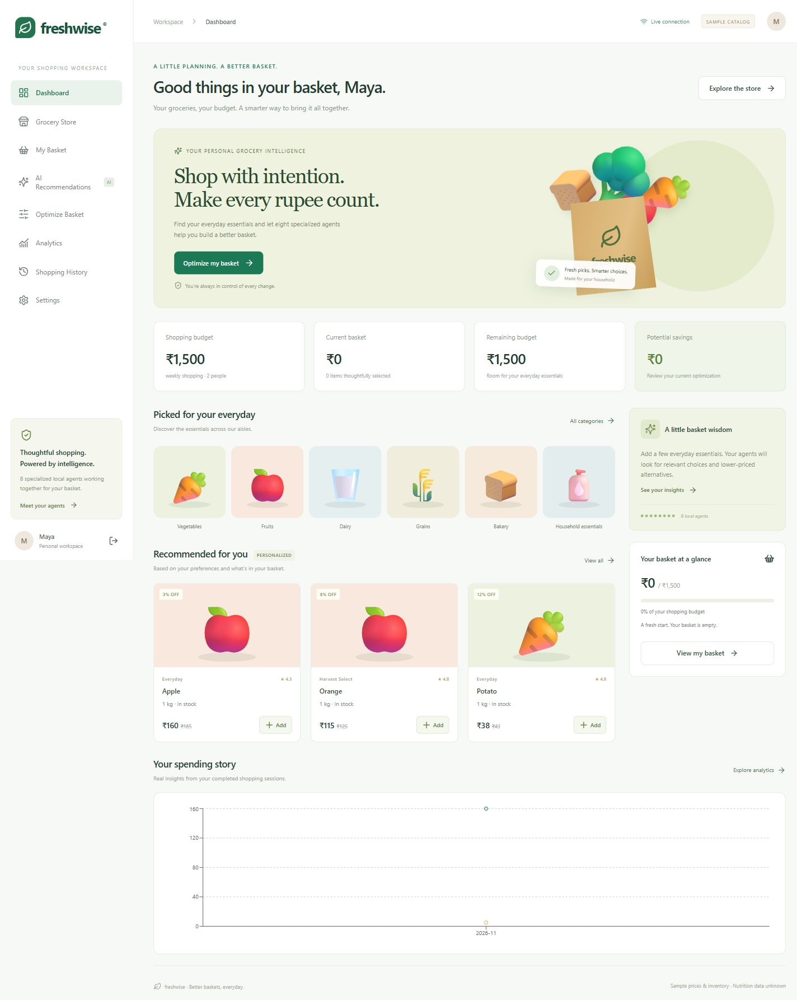

# Freshwise — context-aware grocery basket optimization

A working local React + FastAPI application with 110 sample grocery products, eight cooperating deterministic agents, mathematical basket optimization, authenticated real-time updates, and persisted shopping analytics. No paid service or LLM credentials are required.



## Quick start

Requires Python 3.11+ and Node.js 22+ with npm or pnpm. Run commands from this repository root.

```powershell
python -m venv .venv
.\.venv\Scripts\python -m pip install -r backend/requirements.txt
.\.venv\Scripts\python -m alembic upgrade head
.\.venv\Scripts\python -m uvicorn backend.app.main:app --host 127.0.0.1 --port 8000
```

In another terminal:

```powershell
cd frontend
npm install
npm run dev
```

Open http://localhost:5173 and create your own account. There is no hardcoded account or password. Interactive API documentation: http://127.0.0.1:8000/docs.

SQLite initializes automatically and persists to `grocery.db`. On Linux/macOS use `.venv/bin/python` instead. Development generates a temporary JWT signing key when one is not supplied, so restarting the backend requires signing in again. For stable sessions, set a random `JWT_SECRET` environment variable with at least 32 characters. Local commands read process environment variables; `.env` is consumed automatically only by Docker Compose.

If `venv` fails during `ensurepip` on a managed Windows installation, an existing pip can install into it with `python -m pip --python .venv/Scripts/python.exe install -r backend/requirements.txt`.

## Try the full workflow

1. Register, open Settings, and set your session budget and declared restrictions.
2. Search Grocery Store for **Harvest Select Apple**, priced at sample ₹175/kg, and add it.
3. Open Optimize Basket. Eight agent statuses appear, and the default preferences permit a sample Everyday Apple substitution at ₹160/kg.
4. Review the proposed basket and explanation, then apply or reject it. Applying saves ₹15 in this example. Locked items and required quantities are respected. Restrictive preferences may change the proposal.
5. Complete a sample checkout in My Basket. This saves history and reduces demo stock. Analytics then reflects the actual checkout. No payment occurs.

Every amount in the API and database is an **integer number of paise**. The UI formats INR. Never send rupee floats to monetary fields.

## Docker Compose

```powershell
Copy-Item .env.example .env
# Replace JWT_SECRET and POSTGRES_PASSWORD with random values.
docker compose up --build
```

Open http://localhost:8080. Compose runs PostgreSQL, Redis, the Python backend, and Nginx serving the production frontend. PostgreSQL uses a named volume; database and Redis have no host ports. Use URL-safe characters in the database password, or percent-encode it in a separately supplied database URL. Production requires a stable JWT secret. Put a TLS reverse proxy in front before public hosting.

**Container startup was not verified in this environment because Docker is not installed.** The local SQLite application, frontend build, migrations, and browser workflow were verified. Redis integration is implemented but was not integration-tested against a running Redis service here. Do not treat those two deployment paths as verified.

## Tests

```powershell
.\.venv\Scripts\python -m pytest backend/tests -q
cd frontend
npm test
npm run build
```

Verified: **18 backend tests + 9 frontend tests**, TypeScript compilation, production Vite build, Alembic upgrade/downgrade and schema drift check. See [verification](docs/verification.md) for evidence and limits. GitHub Actions runs the backend suite and frontend tests/build.

## Technical notes and scope

- Eight agents share structured state; recommendation and dietary analysis run concurrently, with timeouts, retries, persisted execution logs, and isolated failures. Execution is explicitly deterministic, not an LLM simulation.
- SciPy MILP chooses same-kind, same-pack substitutions and quantities under budget, stock, diet, allergen, minimum, and locked-item constraints. A conservative greedy fallback reports failure instead of violating a constraint.
- Recommendations combine explicit preferences, personal history, aggregate item co-occurrence, basket/context relevance, content similarity, and an explicitly labeled sample rating proxy. Weights are environment-configurable.
- Suggestions never silently change the basket. Applying uses a revision check, current restrictions, stock and prices. API-only basket changes also schedule debounced automatic analysis.
- Checkout uses database transactions, user row serialization, and conditional stock updates. Data and WebSocket sessions are scoped to authenticated users. Passwords use Argon2; JWTs expire. WebSocket URLs use a short-lived, narrowly scoped ticket rather than the API token.
- Optional Redis supplies user-scoped short-lived event state and pub/sub across backend workers. Without `REDIS_URL`, the local event transport is process-local. Use one worker for the local fallback. Rate limiting and analysis scheduling are process-local; production horizontal scaling requires shared rate limiting and a durable job queue.
- All catalog prices, ratings, brands and stock are **sample data**. All sample nutrition is explicitly **unknown**. Nutrition Focus cannot establish nutrient adequacy until verified source data is supplied. No medical suitability is claimed.
- Monthly budget is a saved planning preference; the session budget is the enforced optimization/checkout constraint. There is no monthly hard spending limit.
- The relational design stores preference documents, order snapshots and optimization details as JSON aggregates instead of introducing one table per field. See the schema rationale below.
- The frontend uses reusable accessible React controls and plain CSS instead of adding Tailwind/shadcn. The Python orchestrator is modular rather than LangGraph, as permitted by the brief. SciPy performs optimization; no LangChain, scikit-learn or LLM is needed for the implemented deterministic hybrid model.
- Catalog artwork is bundled vector category illustration. There is no external inventory/price feed, payment, or external LLM adapter. [Provider integration](docs/provider_integration.md) describes those extension boundaries.

## Documentation

- [Setup and deployment](docs/setup_guide.md)
- [Architecture](docs/architecture.md)
- [API contracts](docs/api_documentation.md)
- [Database schema](docs/database_schema.md)
- [Agent workflow and objective](docs/agent_workflow.md)
- [Provider integration](docs/provider_integration.md)
- [Verification report](docs/verification.md)
- [Implementation checklist](IMPLEMENTATION.md)

## Vercel

See [Vercel deployment setup](docs/vercel_deployment.md). Production is live at https://freshwise-grocery-topaz.vercel.app in the user-owned resum-projects team, with Neon connected and registration, login, optimization, checkout and analytics verified.
